# Solaris Record

Open-source, cross-platform convene (gacha) tracker for Wuthering Waves. Track pity, 5★/4★ history, 50/50 results and statistics across multiple accounts. Local-first, Material 3, built with Flutter.

> Unofficial fan project. It is not affiliated with or endorsed by Kuro Games. Wuthering Waves and its assets belong to Kuro Games.

## Screenshots

### Desktop

<table>
  <tr>
    <td width="50%">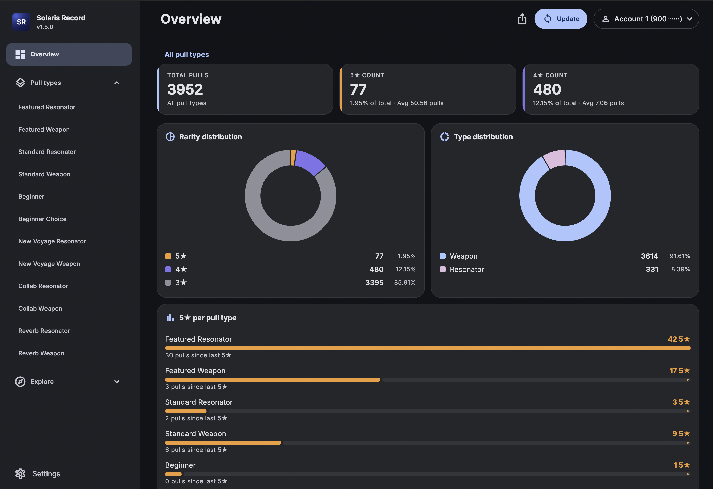<br><sub><b>Overview</b>: totals, rarity and type charts, 5★ per pull type.</sub></td>
    <td width="50%">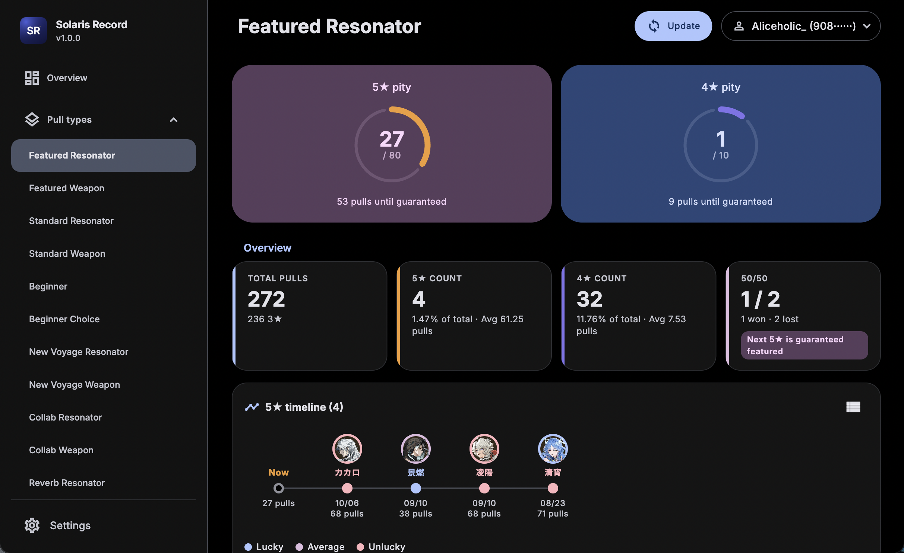<br><sub><b>Featured Resonator</b>: pity, 50/50 record and the 5★ timeline.</sub></td>
  </tr>
  <tr>
    <td width="50%">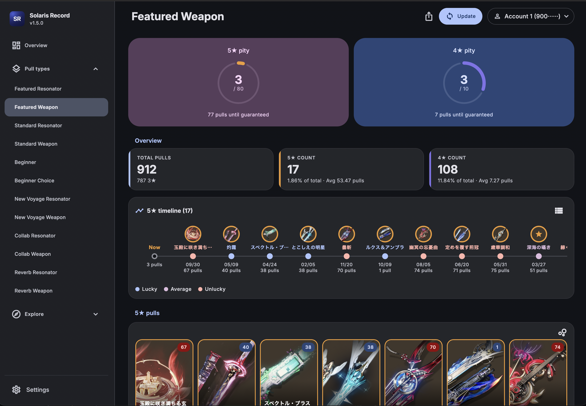<br><sub><b>Featured Weapon</b>: pity and timeline, colored by luck.</sub></td>
    <td width="50%">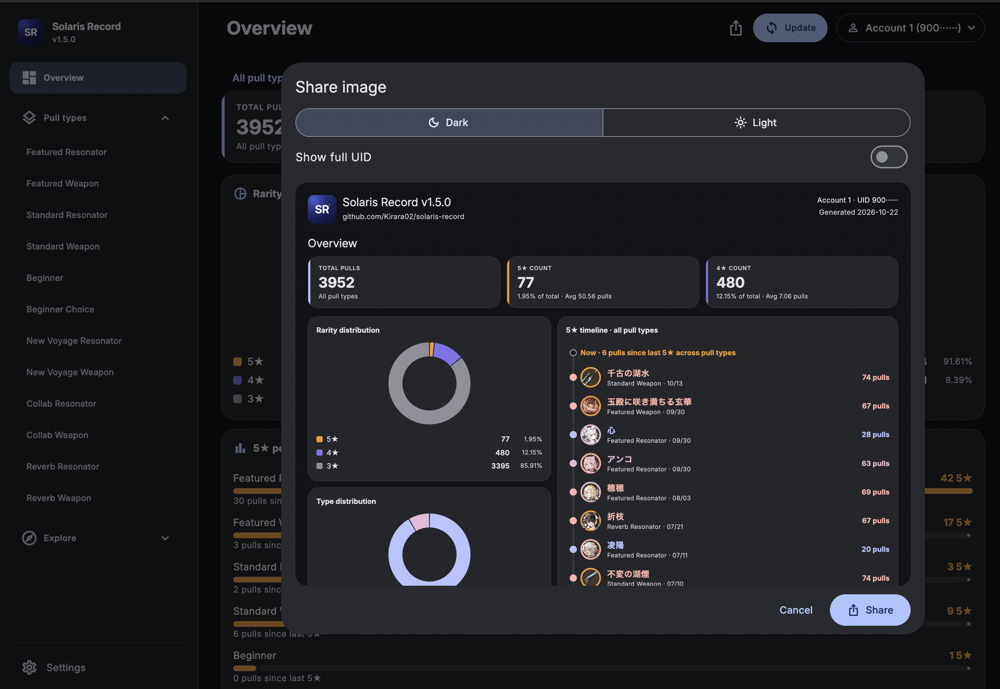<br><sub><b>Item info</b>: details and an icon, outfit and convene art gallery.</sub></td>
  </tr>
  <tr>
    <td width="50%">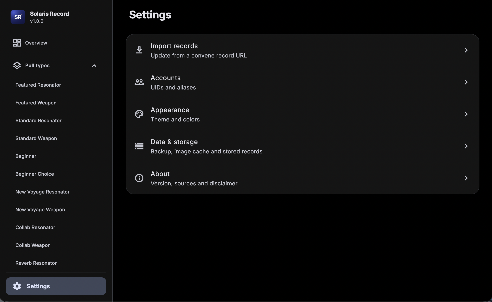<br><sub><b>Settings</b>: import, accounts, appearance, data and about.</sub></td>
    <td width="50%"></td>
  </tr>
</table>

### Mobile

<table>
  <tr>
    <td width="25%" align="center">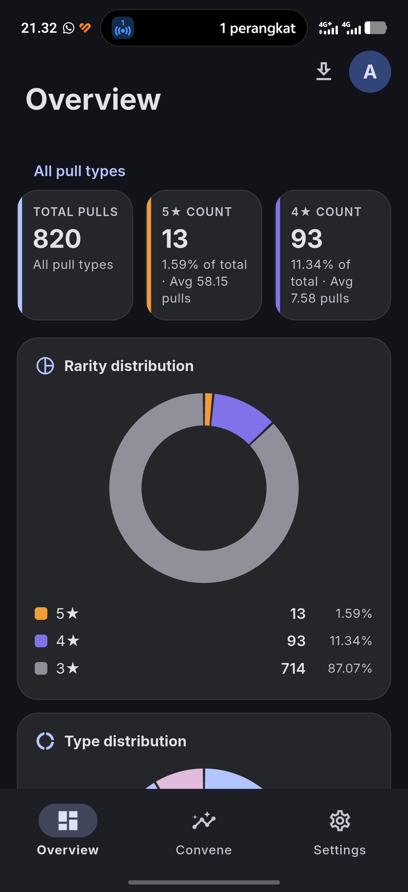<br><sub><b>Overview</b></sub></td>
    <td width="25%" align="center">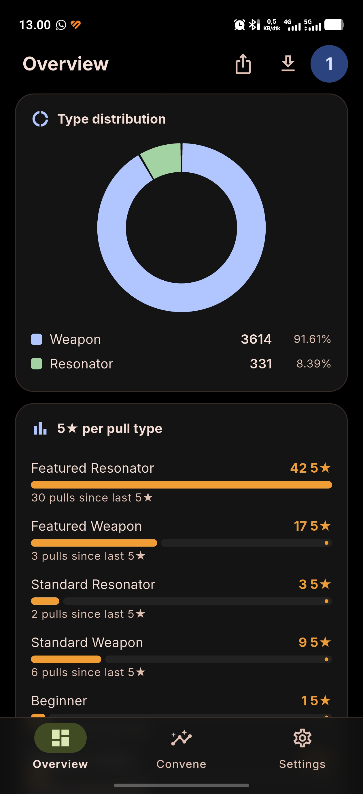<br><sub><b>5★ per pull type</b></sub></td>
    <td width="25%" align="center">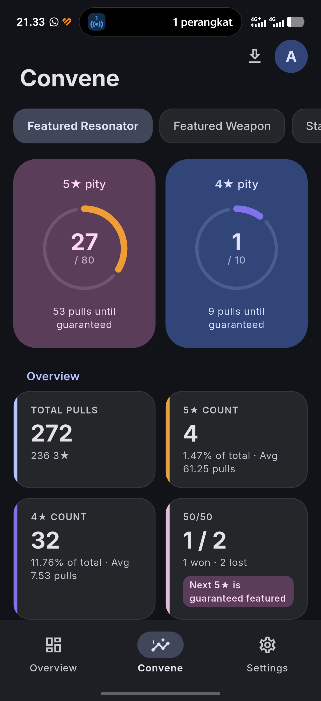<br><sub><b>Pity</b> and 50/50</sub></td>
    <td width="25%" align="center">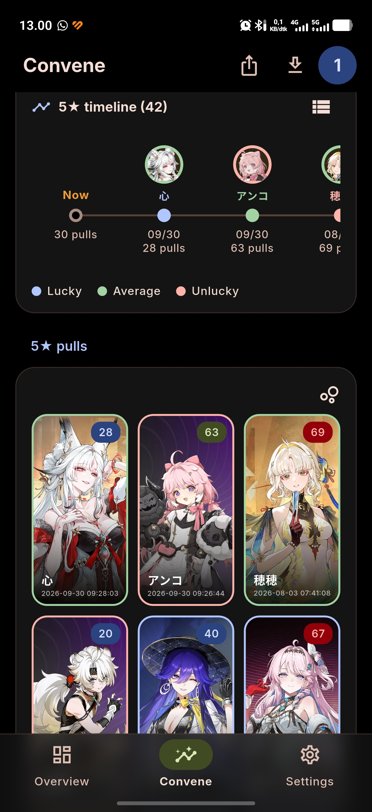<br><sub><b>Timeline</b> and history</sub></td>
  </tr>
  <tr>
    <td width="25%" align="center">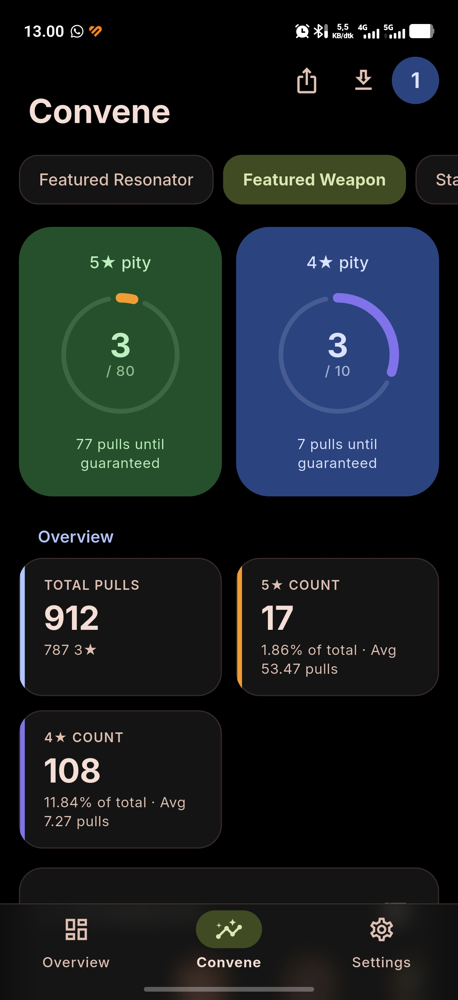<br><sub><b>Featured Weapon</b></sub></td>
    <td width="25%" align="center">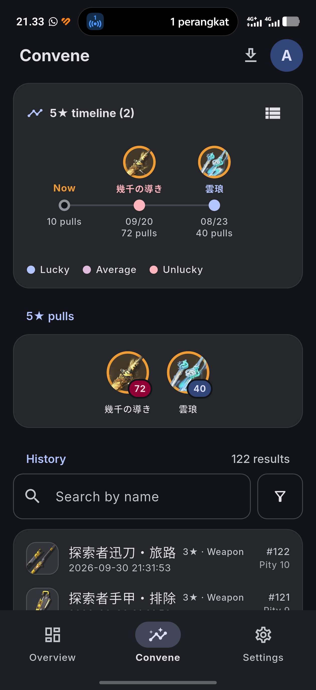<br><sub><b>Weapon timeline</b></sub></td>
    <td width="25%" align="center">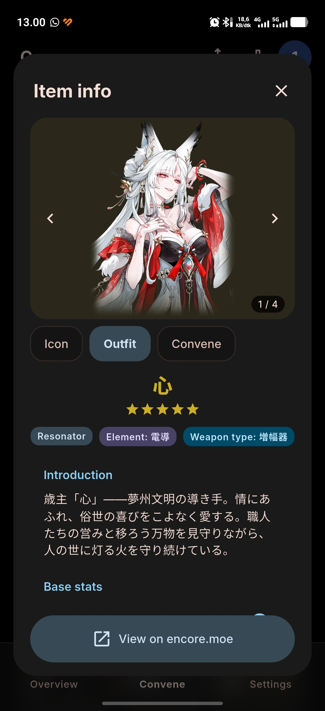<br><sub><b>Item info</b></sub></td>
    <td width="25%" align="center">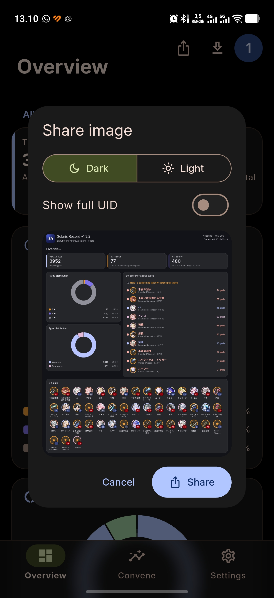<br><sub><b>Settings</b></sub></td>
  </tr>
</table>

## Features

- **Multiple accounts** by UID, with aliases (default "Account N") and an option to mask UIDs everywhere.
- **All 12 convene types**: Featured, Standard, Beginner, Beginner's Choice, New Voyage, Collab and Reverb, for Resonators and Weapons.
- **Pity** for 5★ and 4★ with the pulls left until it is guaranteed, averages, and a **50/50** record for the featured Resonator banner.
- **Timelines** of every 5★, per pull type and across all of them, colored by luck, horizontal or vertical.
- **Overview** with rarity and item type charts, 5★ per pull type, and the current pity of each pull type.
- **History** with search, rarity and type filters, multi-column sort, pull numbers and per-pull pity.
- **Item info** for Resonators and Weapons (skills, effects, base stats by level) with an image gallery (icon, outfit, convene art).
- **Data language**: show item names in another language without touching your stored records.
- **Updates**: the app tells you when a new release is out and, on Android, installs it from inside the app.
- **Backup**: export and import everything as JSON, and import a [WuWa Tracker](https://wuwatracker.com/) export.
- **Quick updates**: the last working link is remembered per account.
- **Material 3** with dynamic color, accent colors and an AMOLED dark mode. English, Indonesian, Japanese and Simplified and Traditional Chinese.
- **Debug log** you can export when reporting a bug. UIDs and links are masked in it.

## How it gets your records

The game keeps your convene history on Kuro's servers and shows it on the in-game *Convene History* page. Solaris Record asks the same service for it with the link of that page, which you copy and paste into the app. It does not intercept network traffic and never touches the game itself.

1. Open *Convene → Convene History* in Wuthering Waves and let the page load.
2. Copy the page's URL. It contains `svr_id`, `player_id` and `record_id`.
3. Paste it into **Import** in the app and tap **Update records**.

The link expires after a short while (roughly 10 to 20 minutes). The game only keeps a limited history, so Solaris Record merges what it fetches into your local data and never deletes older records. Export a backup now and then.

## Privacy

- Everything stays on your device: records live in a local SQLite database.
- The app only talks to Kuro's convene record service (to fetch your records) and to [encore.moe](https://encore.moe/) and Kuro's guide server (for item names, icons and info).
- The link you paste carries an access token for your history, so the app keeps it only until the server rejects it or you delete the account, and never writes it to the debug log.

## Build from source

You need a recent stable [Flutter](https://docs.flutter.dev/get-started/install) (Dart `^3.13.5`).

```bash
flutter pub get
dart run slang                   # translations
dart run build_runner build      # providers, database, assets
flutter run
```

Generated code (`*.g.dart`, `*.gen.dart`) is not committed, so run the two generators after cloning and again after changing providers, database tables, assets or translation files. Run `slang` first.

Useful commands:

```bash
flutter analyze   # lints, must stay clean
flutter test
```

The code is organised by feature under `lib/src/features/`; see [CLAUDE.md](CLAUDE.md) for an architecture overview, including how persistence, merging and the data language work.

## Contributing

Issues and pull requests are welcome. Please run `flutter analyze` before sending a change, and add new strings to every language file in `lib/src/shared/i18n/` (`en`, `id`, `ja`, `zh-Hans`, `zh-Hant`).

## Acknowledgements

- Feature ideas from [WuWa Analyzer](https://github.com/GoneTone/wuthering-waves-convene-gacha-analyzer) (MIT) by GoneTone.
- Theming inspiration from [SpotiFLAC-Mobile](https://github.com/spotiflacapp/SpotiFLAC-Mobile).
- Item data and images from [encore.moe](https://encore.moe/) and Kuro's guide server, loaded at runtime and not bundled with the app.
- [Inter](https://github.com/rsms/inter) typeface (SIL Open Font License).

## License

[MIT](LICENSE) © 2026 Kirara02
