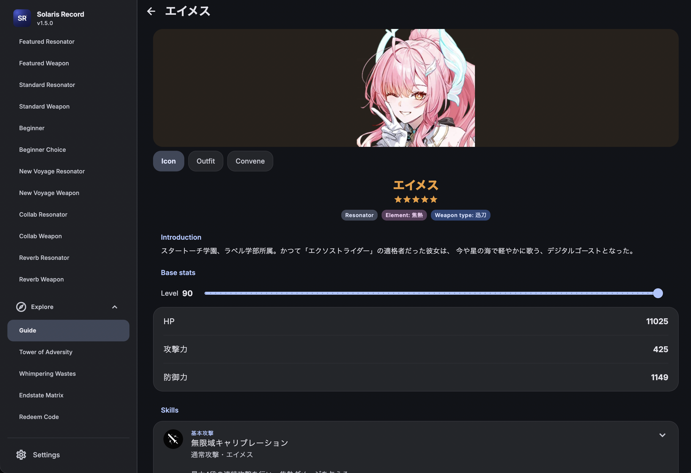
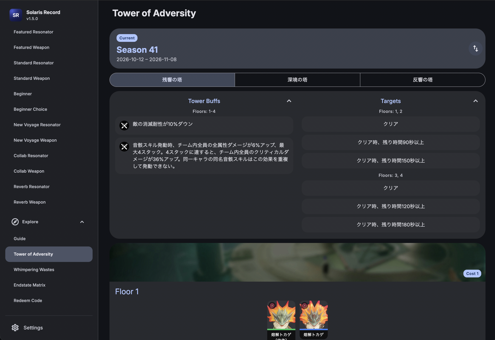
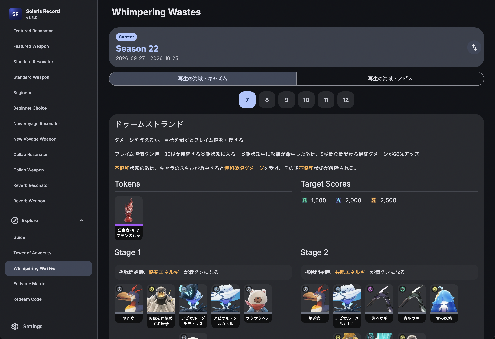
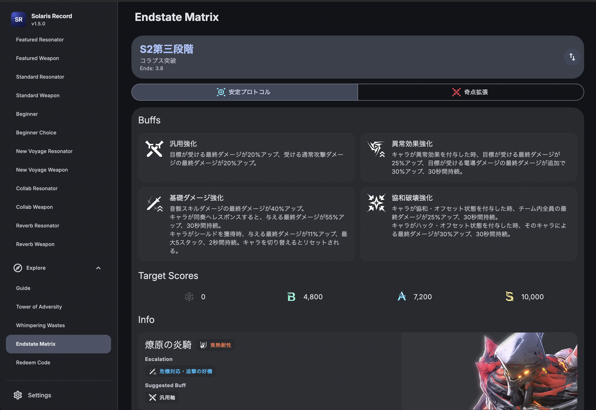
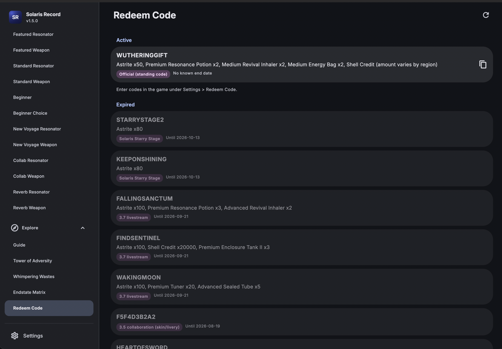
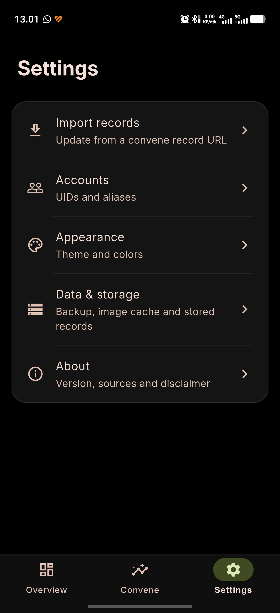

# Screenshots

Back to the [README](../README.md).

## Desktop

<table>
  <tr>
    <td width="50%"> <b>Overview</b>: totals, rarity and type charts, 5★ per pull type.</td>
    <td width="50%"> <b>Featured Resonator</b>: pity, 50/50 record, 5★ timeline and history.</td>
  </tr>
  <tr>
    <td width="50%"> <b>Featured Weapon</b>: pity, stats, timeline colored by luck and history.</td>
    <td width="50%"> <b>Share image</b>: a picture of the overview or one pull type, dark or light.</td>
  </tr>
  <tr>
    <td width="50%"> <b>Guide</b>: Resonators, Weapons and Echoes with search and filters.</td>
    <td width="50%"> <b>Guide detail</b>: skills, stats and an icon, outfit and convene art gallery.</td>
  </tr>
  <tr>
    <td width="50%"> <b>Tower of Adversity</b>: enemies and buffs per season.</td>
    <td width="50%"> <b>Whimpering Wastes</b>: enemies and buffs per season.</td>
  </tr>
  <tr>
    <td width="50%"> <b>Endstate Matrix</b>: enemies and buffs per season.</td>
    <td width="50%"> <b>Redeem Code</b>: current codes with a copy button.</td>
  </tr>
</table>

## Mobile

<table>
  <tr>
    <td width="25%" align="center"> <b>Overview</b></td>
    <td width="25%" align="center"> <b>5★ per pull type</b></td>
    <td width="25%" align="center"> <b>Pity</b> and 50/50</td>
    <td width="25%" align="center"> <b>Timeline</b> and history</td>
  </tr>
  <tr>
    <td width="25%" align="center"> <b>Featured Weapon</b></td>
    <td width="25%" align="center"> <b>Weapon timeline</b></td>
    <td width="25%" align="center"> <b>Item info</b></td>
    <td width="25%" align="center"> <b>Share image</b></td>
  </tr>
  <tr>
    <td width="25%" align="center"> <b>Settings</b></td>
  </tr>
</table>
